

<table class="profile-header" width="100%"><tr><td align="left" width="50%">

  <a href="https://github.com/ajithbuilds"> GitHub</a>
  <a href="https://www.linkedin.com/in/ak12061995/"> LinkedIn</a>
  

</td><td align="right" width="50%">

   &nbsp;  &nbsp; 

</td></tr></table>

  <strong>AJITH KUMAR BALASUBRAMANIAN</strong> 
  <em>Platform Engineer · SRE · MLOps · AI</em>

<a aria-label="Red Hat" href="https://www.redhat.com/en/services/training/red-hat-certified-openshift-administrator-exam">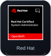</a>
<a aria-label="Kubernetes" href="https://www.cncf.io/training/certification/cka/">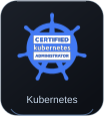</a>
<a aria-label="AWS" href="https://aws.amazon.com/certification/certified-solutions-architect-associate/">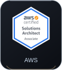</a>
<a aria-label="Azure" href="https://learn.microsoft.com/en-us/credentials/certifications/azure-administrator/">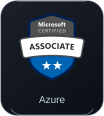</a>

  <picture><source media="(prefers-reduced-motion: reduce)" srcset="assets/static/impact.png" />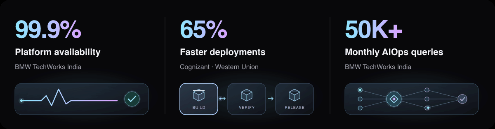</picture>

  <picture><source media="(prefers-reduced-motion: reduce)" srcset="assets/static/role-banner-4k.png" />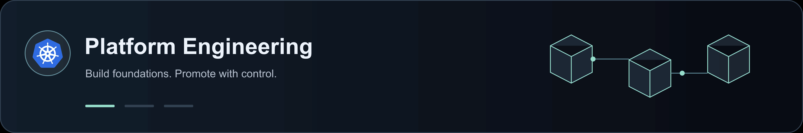</picture>

## Built for Production

<picture><source media="(prefers-reduced-motion: reduce)" srcset="assets/static/production-console.png" />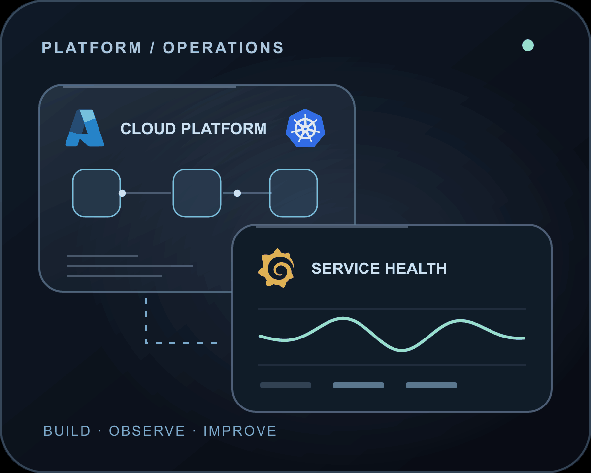</picture>

I’m **AJITH KUMAR BALASUBRAMANIAN**, a Senior DevOps / Platform Engineer with **8+ years of experience** building cloud-native platforms and operating production infrastructure across **AWS, Azure, and GCP**.

At **BMW TechWorks India**, I work on the BMW Group Standard Cloud Platform: internal developer platforms, Kubernetes operations, secure delivery paths, and production reliability for **200+ engineers**.

My focus is practical automation—from self-service infrastructure and incident response to RAG agents, AI-assisted root-cause analysis, and cloud cost optimization.

**Chennai, India** · Open to Platform / SRE roles · [Let’s connect ↗](https://www.linkedin.com/in/ak12061995/)

 
 

  <picture><source media="(prefers-reduced-motion: reduce)" srcset="assets/static/stack-showcase-colour-4k.png" />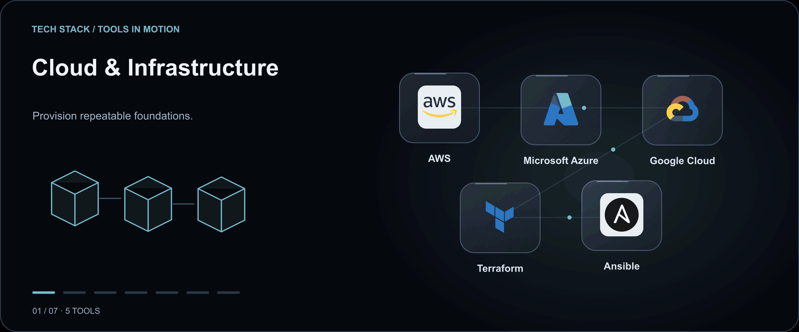</picture>

## Selected Work

### ☁️ 01 / Platform Engineering

Operate **3 AKS clusters and 120+ nodes** across development, integration, and production for 9+ microservices. Maintain **99.9% platform uptime** with Argo CD, Helm, GitOps drift controls, and SLI/SLO dashboards. Upgraded 15+ platform components with zero downtime using rolling updates and verification gates.

Automated lifecycle management for **45+ Azure resource types**, bringing provisioning from hours to **under 10 minutes**, with Terraform golden paths, GitHub Actions, and just-in-time RBAC.

**AKS · Argo CD · Terraform · GitHub Actions · Prometheus · Grafana**

  <picture><source media="(prefers-reduced-motion: reduce)" srcset="assets/static/hero-devops-workflow-4k.png" />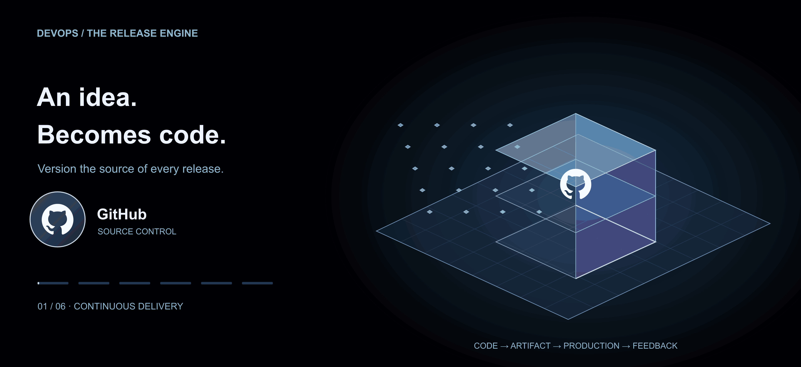</picture>

  <a href="assets/work/platform-glass-architecture.svg" aria-label="Open full-size architecture diagram"><picture><source media="(prefers-reduced-motion: reduce)" srcset="assets/static/work/platform-glass-architecture.png" />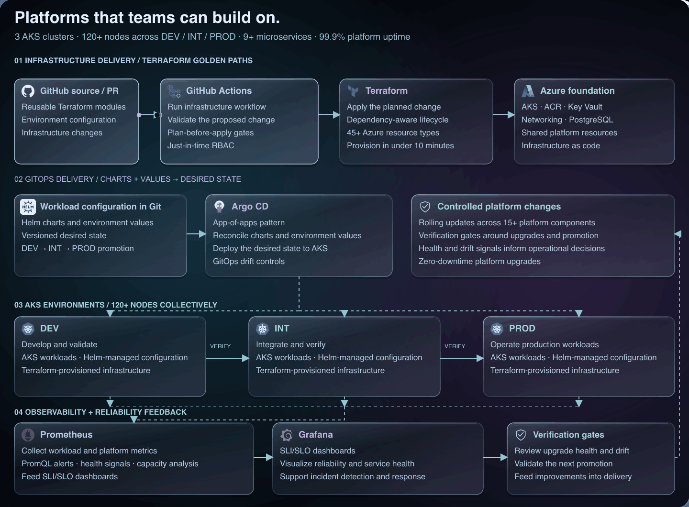</picture></a>

[Open full-size platform diagram ↗](assets/work/platform-glass-architecture.svg)

 

### 🛡️ 02 / Reliability Automation

Built a self-healing Kubernetes sidecar to refresh Azure AD tokens for Grafana PostgreSQL data sources across **10+ databases**, eliminating production authentication failures. Lead P1 incident response, coordinate rollback and failover, and turn postmortems into preventive actions and runbook improvements.

[Explore the public token-refresher repository ↗](https://github.com/ajithbuilds/grafana-postgres-token-refresher)

**Kubernetes · Azure AD · PostgreSQL · Grafana · Incident response**

  <a href="assets/work/reliability-glass-architecture.svg" aria-label="Open full-size architecture diagram"><picture><source media="(prefers-reduced-motion: reduce)" srcset="assets/static/work/reliability-glass-architecture.png" />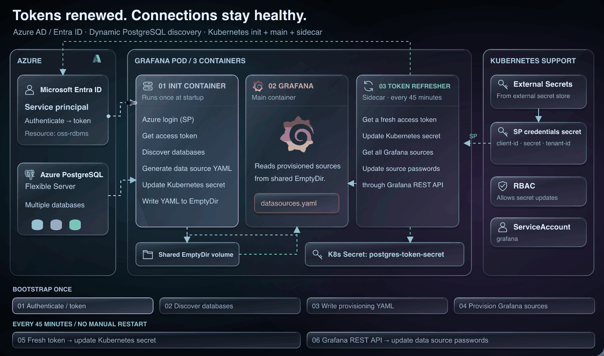</picture></a>

[Open full-size reliability diagram ↗](assets/work/reliability-glass-architecture.svg)

 

### 🧠 03 / AIOps & Knowledge Retrieval

Built a production AIOps agent using LangGraph, Claude/GPT-4, and Azure AI Search. Hybrid vector/BM25 retrieval and semantic reranking support **50K+ monthly queries** and **80% faster documentation lookup** for 200+ engineers. Also built production incident RCA and GitOps drift-detection engines.

**LangGraph · Azure AI Search · Azure OpenAI · RAG · AIOps**

  <picture><source media="(prefers-reduced-motion: reduce)" srcset="assets/static/hero-mlops-4k.png" />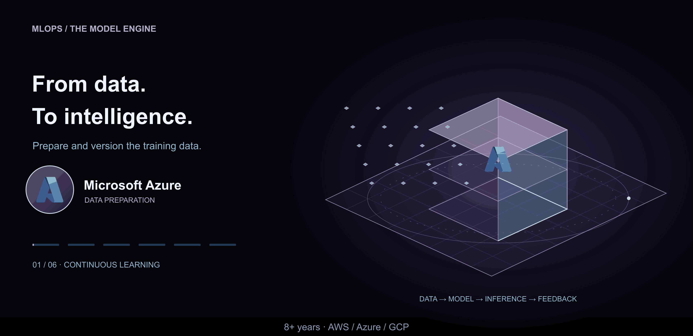</picture>

  <a href="assets/work/ai-agent-glass-architecture.svg" aria-label="Open full-size architecture diagram"><picture><source media="(prefers-reduced-motion: reduce)" srcset="assets/static/work/ai-agent-glass-architecture.png" />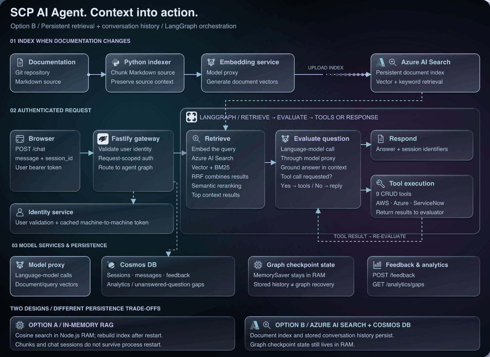</picture></a>

[Open full-size AI agent diagram ↗](assets/work/ai-agent-glass-architecture.svg)

 

### ⚡ 04 / FinOps & Cloud Optimization

Built an AI-driven FinOps pipeline that identified **45% cloud cost waste** and **over €200/month in potential savings per customer**. Right-sizing recommendations become GitHub PRs, flow through Terraform and GitHub Actions, and remain under SLI observation for 48 hours before being closed.

**Azure Cost Management · PromQL · GPT-4o · Azure Functions · Terraform**

  <a href="assets/work/finops-glass-architecture.svg" aria-label="Open full-size architecture diagram"><picture><source media="(prefers-reduced-motion: reduce)" srcset="assets/static/work/finops-glass-architecture.png" />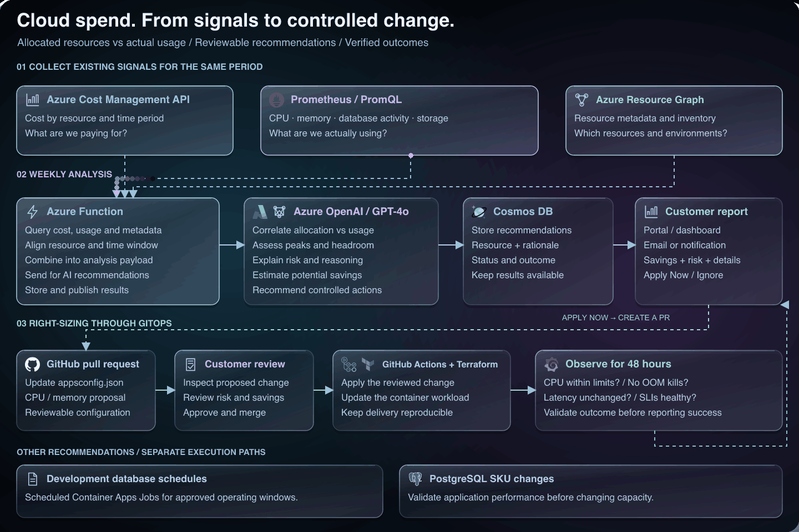</picture></a>

[Open full-size FinOps diagram ↗](assets/work/finops-glass-architecture.svg)

 

## Professional Experience

<table>
  <thead>
    <tr><th>Company</th><th>Role &amp; scope</th><th>Period</th></tr>
  </thead>
  <tbody>
    <tr>
      <td><a href="https://www.bmwtechworks.in/">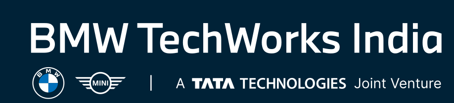</a> <strong>BMW TechWorks India</strong></td>
      <td><strong>Senior DevOps / Platform Engineer</strong> BMW Group · Standard Cloud Platform Kubernetes · GitOps · SRE · AIOps</td>
      <td>Mar 2025 — present</td>
    </tr>
    <tr>
      <td> <strong>Hexaware Technologies</strong></td>
      <td><strong>DevOps Engineer — Platform &amp; Cloud Infrastructure</strong> Client: <a href="https://www.airindia.com/"> Air India</a> AKS · OpenShift · CI/CD · Disaster recovery</td>
      <td>Oct 2023 — Mar 2025</td>
    </tr>
    <tr>
      <td><a href="https://www.cognizant.com/">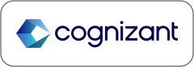</a> <strong>Cognizant</strong></td>
      <td><strong>Technical Lead — Cloud &amp; DevOps Engineering</strong> Client: <a href="https://www.westernunion.com/"> Western Union</a> AWS · Kubernetes · Terraform · Jenkins · GCP</td>
      <td>Dec 2019 — Oct 2023</td>
    </tr>
    <tr>
      <td><a href="https://www.actcorp.in/">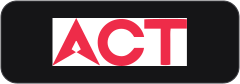</a> <strong>Atria Convergence Technologies</strong></td>
      <td><strong>Network Engineer</strong> ACT Fibernet Network operations · Routing · Incident response</td>
      <td>Oct 2017 — Feb 2019</td>
    </tr>
  </tbody>
</table>

**Earlier career highlights**

- **Hexaware / Air India:** reduced deployment errors by **60%** with GitOps; rehearsed disaster recovery to RTO under 1 hour and RPO under 15 minutes; automated TLS rotation for 20+ microservices.
- **Cognizant / Western Union:** reduced deployment time by **65%** across 10+ services, lowered EC2 compute spend by **35%**, and managed 150+ AWS resources through Terraform.
- **Atria Convergence Technologies:** monitored network health, investigated routing and WAN incidents, and coordinated service restoration with field engineers and vendors.

 

## Tech Stack

### ☁️ Cloud & Infrastructure

<picture><source media="(prefers-reduced-motion: reduce)" srcset="assets/static/tech/aws.png" /></picture> <picture><source media="(prefers-reduced-motion: reduce)" srcset="assets/static/tech/azure.png" /></picture> <picture><source media="(prefers-reduced-motion: reduce)" srcset="assets/static/tech/gcp.png" /></picture> <picture><source media="(prefers-reduced-motion: reduce)" srcset="assets/static/tech/terraform.png" />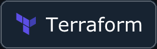</picture> <picture><source media="(prefers-reduced-motion: reduce)" srcset="assets/static/tech/ansible.png" />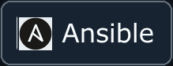</picture>

### 🐳 Containers & Orchestration

<picture><source media="(prefers-reduced-motion: reduce)" srcset="assets/static/tech/kubernetes.png" />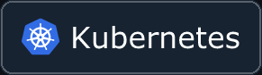</picture> <picture><source media="(prefers-reduced-motion: reduce)" srcset="assets/static/tech/docker.png" />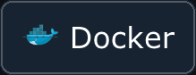</picture> <picture><source media="(prefers-reduced-motion: reduce)" srcset="assets/static/tech/openshift.png" />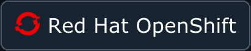</picture> <picture><source media="(prefers-reduced-motion: reduce)" srcset="assets/static/tech/helm.png" /></picture> <picture><source media="(prefers-reduced-motion: reduce)" srcset="assets/static/tech/istio.png" /></picture>

### 🔁 CI/CD & GitOps

<picture><source media="(prefers-reduced-motion: reduce)" srcset="assets/static/tech/argocd.png" /></picture> <picture><source media="(prefers-reduced-motion: reduce)" srcset="assets/static/tech/github-actions.png" /></picture> <picture><source media="(prefers-reduced-motion: reduce)" srcset="assets/static/tech/gitlab.png" />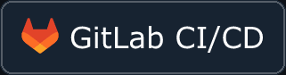</picture> <picture><source media="(prefers-reduced-motion: reduce)" srcset="assets/static/tech/jenkins.png" /></picture> <picture><source media="(prefers-reduced-motion: reduce)" srcset="assets/static/tech/azure-devops.png" /></picture>

### 📊 Observability & SRE

<picture><source media="(prefers-reduced-motion: reduce)" srcset="assets/static/tech/prometheus.png" /></picture> <picture><source media="(prefers-reduced-motion: reduce)" srcset="assets/static/tech/grafana.png" /></picture> <picture><source media="(prefers-reduced-motion: reduce)" srcset="assets/static/tech/datadog.png" /></picture> <picture><source media="(prefers-reduced-motion: reduce)" srcset="assets/static/tech/loki.png" /></picture> <picture><source media="(prefers-reduced-motion: reduce)" srcset="assets/static/tech/opentelemetry.png" />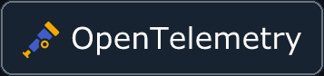</picture>

### 🔐 Security & Identity

<picture><source media="(prefers-reduced-motion: reduce)" srcset="assets/static/tech/vault.png" /></picture> <picture><source media="(prefers-reduced-motion: reduce)" srcset="assets/static/tech/cert-manager.png" /></picture>

### 🧠 AI & MLOps

<picture><source media="(prefers-reduced-motion: reduce)" srcset="assets/static/tech/langgraph.png" /></picture> <picture><source media="(prefers-reduced-motion: reduce)" srcset="assets/static/tech/langchain.png" /></picture> <picture><source media="(prefers-reduced-motion: reduce)" srcset="assets/static/tech/mlflow.png" /></picture>

### 💻 Languages & Scripting

<picture><source media="(prefers-reduced-motion: reduce)" srcset="assets/static/tech/python.png" />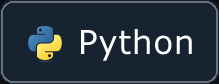</picture> <picture><source media="(prefers-reduced-motion: reduce)" srcset="assets/static/tech/go.png" /></picture> <picture><source media="(prefers-reduced-motion: reduce)" srcset="assets/static/tech/bash.png" /></picture> <picture><source media="(prefers-reduced-motion: reduce)" srcset="assets/static/tech/powershell.png" /></picture> <picture><source media="(prefers-reduced-motion: reduce)" srcset="assets/static/tech/ruby.png" /></picture>

 

## Certifications

Credential names for the badges above:

- **Red Hat Certified Specialist in OpenShift Administration (EX280)** — Red Hat
- **Certified Kubernetes Administrator (CKA)** — Cloud Native Computing Foundation / The Linux Foundation
- **AWS Certified Solutions Architect – Associate** — Amazon Web Services
- **Microsoft Certified: Azure Administrator Associate (AZ-104)** — Microsoft

 

---

  <strong>Open to Platform Engineering, SRE, and Senior / Staff DevOps roles.</strong> 
  Chennai-based · open to remote · practical automation over slideware.  
   &nbsp; / &nbsp;
  <a href="https://www.linkedin.com/in/ak12061995/"> Connect on LinkedIn ↗</a>

 

<!-- Keep this legacy counter URL unchanged: its identifier preserves the existing counter. -->

